  
  
  

---

### About Me

- **Status:** Undergraduate student in **ITPS** (*Computer Science and Software Production Technologies*) at University of Bari Aldo Moro ([**UniBA**](https://www.uniba.it/)).
- **Current focus:** Personal software projects.
- **Learning:** Software engineering and architectures, low-level systems programming, and Computer Science fundamentals.
- **Passions:** Linux ricing, software development, music, racing cars and Formula 1.
- **Ask me about:** Anything you want to talk about.

---

### Tech Stack

**Languages** · C / C++ · Java · Python · JavaScript / TypeScript · PHP · Lua  
**Web & UI** · Next.js · Node.js · Tailwind CSS · Qt / QML  
**Data** · PostgreSQL · MySQL · SQLite · Supabase  
**Tools** · Linux / Arch · Git · Docker · Neovim

---

### Featured Project

---

### GitHub Stats

Thanks for stopping by!

